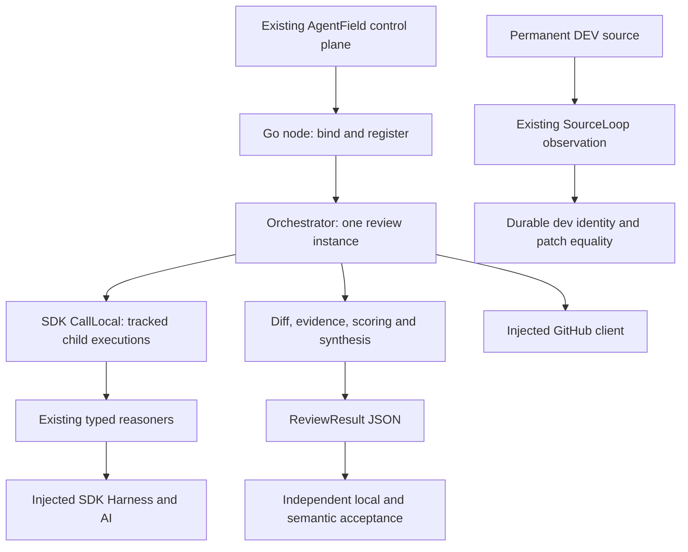
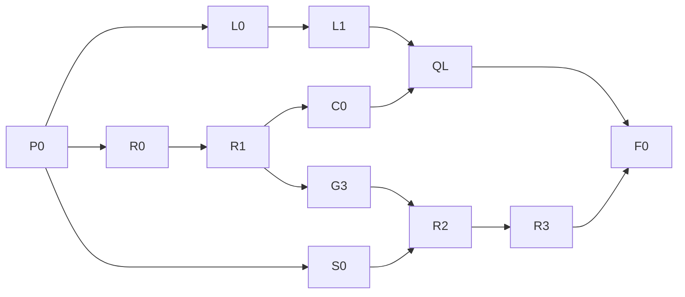

# PR-AF architecture contract

## Purpose, authority and Definition of Done

Deliver one useful evidence-grounded review of a pinned real PR through the maintained Go node in permanent AgentField DEV. This document is the implementation consistency contract for that completion effort. `PLAN.md` remains the sole project gate/status authority; the PRD owns requirements. This document maps them onto existing code and fixes integration boundaries. It does not grant PLAN_ACCEPTED or execution authority.

**FACT:** Baseline HEAD is `dc8d42e366952ff717331ad8a8e33f4e8e297133`; its preceding commits are `093d119` and `90d733a`, both G0 blocker documentation. Initial dirty state is modified `.gitignore` and untracked `.agentfield-out-5axhb_8t/`, `.codex/`, `.graphify-code/`, `.ignore`. Preserve these bytes and do not stage them. Re-inventory before downstream implementation: this baseline is not permanent DEV identity.

**FACT:** G0 remains BLOCKED in canonical PLAN. No CURRENT DEV identity, callback readback, current functional canary, semantic execution or SourceLoop equality was established by this architecture session. Prior config PASS and module-cache/formatting limitations are historical planning receipts, not fresh test results.

**Constraint:** This invocation writes architecture documentation and review receipts only. No product source, manifest, dependency, deployment, shared runtime, credentials, remote Git or task store mutation. Subsequent local changes require the PRD's bounded investigation and exact allowlist. No push, PR, comment, outbound message, paid model execution, deploy, restart or SourceLoop promotion is authorized here.

**ASSUMPTION:** A downstream executor can obtain authorized read-only permanent DEV evidence and, separately, a populated writable Go module cache. If absent, dependent gates remain BLOCKED; independent local assertion work remains eligible.

Architecture DoD: exact existing contracts identified; AC-01–15 mapped to owners and predicates; incompatible independent implementations prevented; document mechanically checked and independently reviewed; unresolved external gates retained. Product DoD remains the PRD's positive semantic and durability requirements. A faithful failure is diagnostic progress and never positive semantic acceptance.

## Existing system and boundary inventory

Retain the existing Go module (`go.mod`: Go 1.21 directive, AgentField SDK v0.1.130). These are repository pins, not recommendations to upgrade. No new framework, database, service, endpoint, queue, dependency or reasoner is introduced.



| Component / owner | Existing files | Contract and dependency boundary |
|---|---|---|
| Entrypoint and installation | `go/cmd/pr-af/main.go`, `go/agentfield-package.yaml` | Maintained executable is built from `./cmd/pr-af`, started as `bin/pr-af`, normally port 8007. Root manifest installs Python for a local path; same node id is not identity proof. No packaging correction in this task. |
| Node adapter | `go/internal/node/node.go`, `register.go`, `webhook.go` | Resolves SDK configuration, registers 17 handlers, binds `ReviewInput`, resolves repo/config, injects capabilities, maps errors. Webhook is a separate externally mutating path and is excluded from verification. |
| Request/response data | `go/internal/schemas/input.go`, `output.go`, `defaults.go` | Sole owners of public types, JSON tags and seeded collection/default behavior, including UnmarshalJSON in defaults.go. Reuse, never duplicate schema structs in a verifier. |
| Per-review state and dispatch | `go/internal/orch/orchestrator.go`, `phases.go`, `resolve.go`, `synthesis.go`, `output.go` | Orchestrator owns review state, fan-outs, joins and terminal result. Production supplies SDK agent as `Deps.Local`. Configured gates retain existing behavior. |
| Reasoner adapters | `go/internal/reasoners/`, `afx/`, `harnessx/`, `gates/` | Typed input is bound through existing adapters. Model/harness calls use injected SDK surfaces. Preserve prompt/parse degradation behavior. |
| Deterministic transformations | `go/internal/diffengine/`, `evidence/`, `scoring/`, `prompts/` | Existing pure/code transformations and evidence preparation; no new model calls for deterministic work. |
| GitHub adapter | `go/internal/github/client.go` | Fetch and post through injected `github.Client`; tests use recording fakes or local HTTP transports. Product posting remains governed by the existing output guard. |
| Configuration | `go/internal/config/` | Sole owner of input/env/default precedence, per-review limits and AI/harness configuration. Tests cannot mutate global machine settings. |
| Offline evidence | Existing `go/internal/*/*_test.go`, `go/Makefile`, `.github/workflows/ci.yml` | Real test events and exit codes, not success-shaped strings. Future narrow acceptance correction belongs in existing runner/test surface selected by L0. No new acceptance daemon. |
| Functional fixture | `go/test/functional/`, `go/test/e2e/`, `go/test/mockcli/` | Isolated lifecycle tests and mocked fixtures; neither proves permanent DEV or real semantic quality. |
| Runtime and durability observations | Existing AgentField DEV and SourceLoop interfaces; `PLAN.md` | External ownership. Observer records evidence; PR-AF code never implements fleet selection, restarts, capture promotion or compensating orchestration. |

Source verification used Graft CLI `check` and `ask --source`, followed by exact reads of the above material contracts. Wiring freshness was OK; all 1757 semantic nodes were pending and the deep layer was absent. Codebase Memory MCP project/coverage tools were not exposed in the enabled inventory, so no generation/coverage claim is made. No exhaustive static call-graph or AST enforcement claim is made. This design adds no gateway or retry policy; any later shared-symbol change requires inbound/outbound impact discovery and the repository's architecture-fitness checks before editing.

## AD-1 — Adopt the existing Go capability boundaries [ADOPTED]

**Binds:** node, orchestrator, reasoners and tests.

**Prevents:** independently invented pipeline engines, duplicate schemas and bypassed SDK instrumentation.

**Rule:** Use the following existing declarations verbatim. They are references to existing code, not instructions to redeclare types. Imports retain existing SDK aliases `agent`, `ai`, `harness`, and local packages `github`, `schemas`, `config`.

```go
// go/internal/orch/orchestrator.go
type App interface {
    Harness(ctx context.Context, prompt string, schema map[string]any, dest any, opts harness.Options) (*harness.Result, error)
    AI(ctx context.Context, prompt string, opts ...ai.Option) (*ai.Response, error)
    Pause(ctx context.Context, opts agent.PauseOptions) (*agent.ApprovalResult, error)
    Note(ctx context.Context, message string, tags ...string)
}

type LocalCaller interface {
    CallLocal(ctx context.Context, reasonerName string, input map[string]any) (any, error)
}

type Deps struct {
    App              App
    GH               github.Client
    NodeID           string
    AgentFieldServer string
    Local            LocalCaller
}

func New(d Deps, in schemas.ReviewInput, cfg config.ReviewConfig) *Orchestrator
func (o *Orchestrator) Run(ctx context.Context) (schemas.ReviewResult, error)

// go/internal/github/client.go
type Client interface {
    ParsePRURL(url string) (owner, repo string, number int, err error)
    FetchPR(ctx context.Context, owner, repo string, number int) (schemas.GitHubPRData, error)
    PostReview(ctx context.Context, owner, repo string, number int, review schemas.GitHubReview, commitID string) (map[string]any, error)
}

// go/internal/node/node.go and register.go
func BuildAgent(defaultNodeID, defaultPort, description string) (*Node, error)
func (n *Node) RegisterAll()

// go/internal/config/budget.go and review.go
func ResolveBudgetCaps(maxCostUSD *float64, maxDurationSeconds *int) (float64, int, error)
func (ReviewConfig) FromInput(in schemas.ReviewInput) (ReviewConfig, error)
```

Production must retain `localCaller: app` in `BuildAgent`, forwarded into `orch.Deps.Local`; `New` selects `callLocalSeams` for nonnil Local. Nil Local is an intentional offline-test fallback, not permission for a new production path. Existing `viaLocal[T]` uses `afx.ToMap`, `CallLocal` and typed binding at the registered reasoner. Preserve parent `context.Context`; do not construct unrelated child roots or hand-build execution records.

## AD-2 — Preserve wire types and error mapping [ADOPTED]

**Binds:** callers, node adapters, fake harnesses and result validators.

**Prevents:** missing-vs-zero budget drift, incompatible response shapes and failures rendered as approvals.

**Rule:** Import `schemas.ReviewInput` and `schemas.ReviewResult`. The exact request field contract is:

| Go fields | Go type | Exact JSON names |
|---|---|---|
| PrURL, DiffText, RepoPath, BaseRef, HeadRef | `*string` each | `pr_url`, `diff_text`, `repo_path`, `base_ref`, `head_ref` |
| Depth, Focus, OutputFormat, SuggestionMode | `string` each | `depth`, `focus`, `output_format`, `suggestion_mode` |
| MaxCostUSD | `*float64` | `max_cost_usd` |
| MaxDurationSeconds | `*int` | `max_duration_seconds` |
| IgnorePaths, Hints | `[]string` each | `ignore_paths`, `hints` |
| Models | `map[string]string` | `models` |
| MaxConcurrentReviewers, MaxCoverageIterations | `*int` each | `max_concurrent_reviewers`, `max_coverage_iterations` |
| MaxReviewDepth | `int` | `max_review_depth` |
| DryRun | `bool` | `dry_run` |
| PostPRNumber | `*int` | `post_pr_number` |

Pointers preserve omission/null until existing config resolution. Do not flatten to concrete cap defaults in a new adapter. Preserve existing schema default seeding (including `dry_run=false`) and input precedence: nonempty PR URL, then diff text, then repo path inside intake. Verification explicitly sends dry_run; it must not rely on default false becoming safe. Node repository resolution happens before orchestration and can clone/fetch for a PR URL; dry-run is not a network-off switch. Use supplied local fixtures for offline tests.

```go
// Existing go/internal/schemas/output.go
type ReviewResult struct {
    ReviewID string         `json:"review_id"`
    PrURL    string         `json:"pr_url"`
    Review   GitHubReview   `json:"review"`
    Findings []ScoredFinding `json:"findings"`
    Summary  ReviewSummary  `json:"summary"`
    Metadata ReviewMetadata `json:"metadata"`
}
```

Nested types remain exactly as defined in `output.go`: review `body/event/comments`; findings retain location, severity, evidence, confidence, score, blocking axis and all existing tags; summary retains cost/duration/budget fields; metadata retains intake/anatomy/plan/budget, invocation count, phases and actual degraded-dimension count. Preserve seeded empty arrays/maps rather than introducing nulls. No acceptance fields are added to this public result.

Binding/config errors remain HTTP 400-class SDK `ExecuteError`; repository resolution failures remain 500 before the mapped orchestration try-path. `errors.Is(err, orch.ErrBadInput)` maps to 400/raw message. Other orchestration failures emit the existing review/error note and map to 500 with `review execution failed: ` prefix. All-dimension schema parse failure must return failure before output. Partial degradation reports actual failed dimensions; no fabricated clean approval.

## AD-3 — Preserve conditional DAG semantics and state ownership [ADOPTED]

**Binds:** orchestrator and independent DAG verifier.

**Prevents:** treating discovery as execution, inventing phase order, or mutating per-review state across requests.

**Rule:** One orchestrator instance owns one review. Preserve mutex protection for concurrent counters, indexed fan-out result order, existing semaphores, channel ownership/close and errgroup joins. Do not reuse an orchestrator across reviews. Preserve repository-per-PR workspace isolation and head refresh in existing `resolve.go`.

Actual shape: intake -> anatomy -> three meta lenses/dynamic plan -> dimension review plus evidence/adversary/compound layer -> coverage and consistency in parallel -> deterministic synthesis -> optional merge gate -> output. When post-worthiness gate is enabled, reviewers finish before selection and the heavy layer; when disabled, review and layer stream. The HITL revision path exists only for a PR URL with dry-run false; verification bypasses it by explicit dry-run true. Preserve this conditionality and existing reasoner input types in `reasoners/`; no new phase interface is needed.

Discovery requires exact set equality with these 17 names, normalizing a node prefix only when the actual API encodes it:

```text
review
intake_phase
anatomy_phase
planning_phase
meta_semantic
meta_mechanical
meta_systemic
review_dimension
compound_finder_phase
post_worthiness_gate
compound_dedup_phase
evidence_verifier
adversary_phase
deepen_findings
extract_obligations
verify_obligation
coverage_gate
```

`review` has no domain tags; children have `review,pr` where exposed. Classify each reasoner's tag observation as EXACT, API_FIELD_ABSENT, MALFORMED or MISMATCH. Only EXACT and API_FIELD_ABSENT are non-failing; the latter narrows the claim. An exposed empty/null/wrong-shaped child tag field is never API_FIELD_ABSENT. Compare child tags as a set; for review an exposed empty set is EXACT. Missing callback reachability blocks G0. Discovery of all names does not require all handlers to execute. Compare actual child execution records, parent links and terminal states with the path selected by input/config. `metadata.phases_completed` is populated from a static phase list in output and is not authoritative proof that every child ran. Fatal child/schema failures reject positive G3; retain raw DAG and result before diagnosis.

## AD-4 — Dry-run proves a posting boundary, not unrestricted execution [ADOPTED]

**Binds:** output owner, test owner and runtime observer.

**Prevents:** a no-op test passing without reaching the post guard and dry-run being mistaken for isolation.

**Rule:** Verification requests explicitly use `dry_run=true`, omit `post_pr_number`, bypass webhook and posting utilities, and retain the real output path. The existing guard in `output.go` is `postToGitHub && !o.input.DryRun && strp(o.input.PrURL) != ""`. Do not change its default or public API for this effort.

If L0 confirms a coverage gap, extend package-local `go/internal/orch/output_test.go` using existing fakes. Initialize valid PR data, nonempty PR URL and result prerequisites; disable polish or inject AI so no external call occurs. Invoke real `generateOutput` with `postToGitHub=true` and dry-run true; require zero recorded writes and a valid result. Repeat through the real orchestrator path with existing injected phase seams if needed to prove forwarding. Positive control uses the same fake/prerequisites with dry-run false, no HITL path and direct output invocation: require a recorded PostReview call. Negative cases also cover postToGitHub=false and absent URL. The positive control never uses a live GitHub client.

The recorder implements the existing Client exactly, is race-safe if used concurrently, and counts all physical calls including fallback/retries. Any test transport rejects unexpected mutating HTTP methods; no live credential or network path is allowed. A zero recorder count plus source path coverage supports local AC-05 only. Current DEV zero-write proof additionally needs authorized request/audit/effect evidence for the execution and interval, including model-tool effects; dry-run alone cannot prove an unrestricted harness made zero mutations. If such evidence is unavailable, AC-10 stays unverified. Do not add a security gateway or claim sandbox enforcement from this design.

## AD-5 — Observe current identity before runtime admission [ADOPTED]

**Binds:** runtime observer, root reducer and SourceLoop observer.

**Prevents:** a healthy Python node, stale Go binary or unrelated namespace satisfying G0.

**Rule:** Bind a sanitized timestamped observation bundle to one permanent DEV/container/process generation: installed entry `/afhome/installed.yaml`; watched `/src/pr-af` HEAD/status and exact diff; installed manifest/layout under `/afhome/packages/pr-af`; process argv/executable, binary hash/build metadata and listener; control-plane identity/discovery; effective callback/PublicURL and its reachable health from the CP namespace; SourceLoop watch/base/proposal/durable-dev readback. Source-to-binary link needs build metadata or equivalent existing build/capture receipts. Unknown link blocks G0.

`AGENT_CALLBACK_URL` maps directly to SDK PublicURL in BuildAgent. Never replace the observed URL with a guessed host/port, or substitute Windows health for CP-namespace reachability. Re-read identity immediately before and after a canary/semantic run. Source, artifact, config, process generation or PR pin drift invalidates dependent evidence; rerun the affected gate only after reconciliation.

No exact runtime URI or command is invented. Observer first binds the actually available authorized interface/version. Missing interface produces BLOCKED with no execution id, not a fake request. If Python is observed, assign implementation selection to orchestration. Callback/supervision/provider/cache failures are classified at their owner; they do not release compensating PR-AF source changes. Runtime reload/install/repair remains outside current authority even after observation.

## AD-6 — Limits and spend claims remain distinct [ADOPTED]

**Binds:** config owner, canary/semantic caller and QA.

**Prevents:** silently raised limits and treating recorded zero cost as provider enforcement.

**Rule:** Explicit cost/duration input > corresponding environment > defaults ($2, 3600 seconds), as `ResolveBudgetCaps` implements. Keep intentional model defaults: code fallback minimax/minimax-m2.5, manifest/container default deepseek/deepseek-v4-flash-0731, provider aforge. Record effective harness model and AI model separately; the AI API model strips the existing openrouter routing prefix. Do not normalize these defaults.

| Request profile | max_cost_usd | max_duration_seconds | max_concurrent_reviewers | max_coverage_iterations | max_review_depth |
|---|---:|---:|---:|---:|---:|
| Current DEV canary | 0.25 | 300 | 1 | 1 | 1 |
| Pinned semantic review | 2 | 3600 | 2 | 1 | 1 |

Both profiles explicitly set dry_run true and omit post_pr_number. Use existing ReviewInput fields and read effective config back; JSON numeric fields must be numbers, not strings. Do not silently increase a limit after a timeout. Record elapsed/deadline and existing cancellation/reconciliation receipt. The source's phase duration checks and `TestWallClockBudgetTrips` do not prove interruption of every in-flight external call. If the observed interface cannot provide required bounded execution/cancellation, admission remains BLOCKED.

`TestCostStaysInert` documents lack of real provider cost accumulation. No hard spend claim follows from max_cost_usd, reported cost 0 or phase caps. Before a paid request, require an already existing provider-side bound or verified accounting/enforcement covering both harness and AI calls and retries. Otherwise record BLOCKED_SPEND_ENFORCEMENT. No new billing/accounting subsystem is in scope. BuildAgent attaches AIConfig only when OPENROUTER_API_KEY is present; successful construction does not prove usable provider credentials.

## AD-7 — Test evidence must contain actual mandatory passes [ADOPTED]

**Binds:** local test owner, functional runner and independent QA.

**Prevents:** exit-zero skips, absent tests and package-only pass events satisfying acceptance.

**Rule:** Capture unmodified `go test -json` stdout, stderr and actual process exit code. Identify events by `(Package, Test)`, not Test alone. For each required top-level name require a run event followed by terminal pass; a skip/fail in that mandatory test or descendant, missing test, malformed/truncated JSON, missing package terminal pass, nonzero process exit or zero executed required tests rejects PASS. Package-level pass cannot substitute for a test-level event. Use `-count=1` to avoid cached receipts. Concurrent event interleaving is valid; input order is retained within each test identity. Diagnostic output events are not assertions.

Future narrow runner corrections must consume these existing events in the existing verification lane. Do not create a competing application API, acceptance server, package-wide skip exemption or success marker. Exact writer path is frozen by L0 after deduplication; this document does not authorize speculative runner implementation. One L0/L1 test-evidence owner owns the shared reducer for AC-04/06/08/09; separate functional/node/orch reducers or competing TestMain skip-policy changes are prohibited. L0 must record the single existing or minimally extended entrypoint, exact invocation and write allowlist before release. Its acceptance function is the AD-7 event predicate, independent of placement.

The shared reducer's interchange format is `go-test-events/v1`: input is the unmodified UTF-8 JSON-lines stdout file, separate stderr file, integer process exit code and explicit ordered list of mandatory `(Package, Test)` identities. Output is one receipt with header fields `format=go-test-events/v1`, `command`, `exit_code`, `stdout_artifact`, `stderr_artifact`, `status`, `reason`; and one table row per mandatory identity with exact columns `package`, `test`, `run_seen`, `terminal_action`, `descendant_skip_or_fail`, `package_terminal_action`, `status`, `reason`. Booleans are true/false; terminal actions are pass/fail/skip/missing. Overall status is PASS only when all predicates above pass. Executed invalid evidence is FAIL; unavailable command/prerequisites is BLOCKED. Required identities absent from an executed transcript are FAIL, never BLOCKED or silently removed. All AC groups use this same receipt shape. Offline negative-control fixtures use the identical input tuple and expected status; no regex search for a PASS string is equivalent. This contract can be serialized as the existing receipt format or Markdown header/table with these exact labels; no new product wire type is introduced.

Required node set (AC-04): `TestRegisterAllExactSurface`, `TestBuildAgentFromEnv`, `TestBuildAgentWiresLocalCallerToApp`, `TestReviewHandlerForwardsLocalCaller`, `TestReviewHandlerErrorMapping`.

Required orch set (AC-06): `TestRunFailsBeforeOutputWhenAllDimensionsFailSchemaParsing`, `TestMixedAndCleanDimensionsExposeOnlyActualDegradation`, `TestReviewResultKeySetParity`, `TestCheckoutReusedWorkspaceUpdatesToNewPRHead`, `TestResolveRepoKeysWorkspacePerPR`, `TestWallClockBudgetTrips`.

Functional set (AC-09): `TestHealth`, `TestRegistrationParity`, `TestReviewErrorShape` in the functional package, plus actual isolated-stack identity/readiness evidence. Docker-unavailable and readiness-timeout transcripts must be rejected even if their Go process exits zero. Also reject missing test and fabricated package-only pass; accept a complete genuine passing event stream. Exercise these verifier cases offline, without starting Compose. Independent QA must verify fixture transcripts reflect the real skip paths.

From `go/`, run focused node/orch sets with anchored `-run` alternatives and `-json -count=1`, then config tests; broader checks are `go build ./...`, `go vet ./...`, `go test -json ./... -count=1`, and read-only `gofmt -l .` (must print nothing). A formatter listing is FAIL, not a reason for blanket formatting. Changed Python/scripts also require existing `ruff check src/ scripts/` and affected pytest checks. Preserve exact commands, exits and raw output; dependency setup failure is BLOCKED_ENV, not a pass or proof of a product regression.

Do not run `go test -tags functional -json ./test/functional -count=1` in this scope: it starts/builds/stops an isolated Compose project. Even when later authorized and passing it is not permanent DEV G3. `go/test/e2e/run.sh` uses Bash, starts runtime components, mocks the harness but calls real AI; missing credentials can exit zero. It cannot satisfy AC-11.

## AD-8 — Semantic acceptance belongs to independent frozen witnesses [ADOPTED]

**Binds:** fixture selector, semantic runner and independent QA.

**Prevents:** goldens leaking into prompts, oracle drift and plausible text being accepted as correctness.

**Rule:** QA selects from existing benchmark `problems.json`: ascending changed-line count among recoverable real PRs with reproducible correctness/security issues, lexical URL tie break. Missing selection data blocks selection. Pin URL/owner/repo/number, base/head SHAs, snapshot and diff SHA-256 hashes before execution. A mutable PR URL alone is insufficient. If live intake is needed, compare fetched base/head/diff to pins before judging; drift rejects that attempt. Prefer an available read-authorized pinned local snapshot; no synthetic substitution.

QA freezes separately from PR-AF inputs: root cause, exact file/line range in pinned source, safe failing head witness, minimal mitigation with passing witness, and safe behavior/mitigation negative controls. Run witnesses only in an authorized disposable environment; never alter the canonical PR or expose golden root causes as review hints. Unsafe/unreproducible candidates are ineligible; choose next or report BLOCKED_SELECTION.

Before R2, QA freezes the oracle's cause/witness/control IDs and an adjudication table template. After execution it writes one row per emitted finding with exact columns `finding_id`, `result_artifact_sha256`, `finding_index`, `severity`, `pinned_head_sha`, `source_path`, `line_start`, `line_end`, `oracle_cause_id`, `head_witness_artifact`, `mitigation_witness_artifact`, `negative_control_artifact`, `evidence_decision`, `reviewer`, `verdict`, `reason`. Join by result hash plus zero-based finding_index; finding_id alone is not unique enough. Verdict is SUPPORTED, UNSUPPORTED or BLOCKED. The positive matched cause requires frozen failing-head/passing-mitigation witnesses. Additional findings may use verified static proof instead: witness columns explicitly say NOT_APPLICABLE_STATIC_PROOF, with the proof artifact and rationale in reason. Missing proof is BLOCKED, never implicit support. Negative controls get separate rows keyed by frozen control ID and result artifact hash, recording expected-safe behavior and observed critical/important false-positive count, which must be zero.

AC-11 requires current unmocked Go output with at least one correct root cause/location and useful impact/evidence; each emitted finding receives independent evidence adjudication, with every critical/important claim supported and zero false critical/important claims on negative controls. Retain witness commands, exits, outputs/hashes, raw review, execution DAG, model configuration, pins and reviewer identity. Model judge text, historical benchmark scores, string matching, mocked findings and SDK succeeded are supporting evidence only. Failure/abstention sets positive semantic acceptance false and preserves the attempt.

## AD-9 — Evidence reduction and durability cannot be self-certified [ADOPTED]

**Binds:** all task owners, root reducer and QA.

**Prevents:** local commits being mistaken for runtime closure and workers accepting their own claims.

**Rule:** Use the PRD's P0/R0/L0/L1/QL/R1/C0/S0/R2/R3/F0 dependencies without a new tracker. Maximum three concurrent workers total; reserve a slot for independent QA once a candidate exists. Root owns PLAN updates/integration, one writer owns exact approved test/script files, independent QA owns only its review receipt. Serialize conflicting writes. Advisor availability must be observed; absent callable advisor is ADVISOR_UNAVAILABLE, never fabricated advice. No shared Factory/task mutation is authorized by this design.



C0 is conditional on a proven component defect; G3 may proceed with an evidenced no-code-change case when G0 and execution prerequisites pass. Local QL does not satisfy runtime revalidation. R3 also requires R0 and either accepted runtime delta or proved no-delta case; G4 failure does not manufacture accepted runtime delta. All runtime execution edges additionally require explicit execution authority, callback and bound/spend prerequisites. Initial independent frontier R0/L0/S0 is descriptive, not a release while PLAN_ACCEPTED/admission is missing.

Evidence belongs beside existing task/attempt receipts, referenced from canonical PLAN after meaningful evidence changes. Do not introduce a new persistent evidence database. Every receipt must identify baseline/source SHA, task, owner/reviewer, UTC observation time, environment/generation, exact command/interface, exit/terminal status, sanitized raw artifact paths and SHA-256 hashes, expected/actual, classification and blocked prerequisites. Hash raw preserved bytes, not reformatted text. Paths are repository-relative for local artifacts; runtime paths are labeled with environment identity. Secret values are excluded; retain only credential presence/shape. These are receipt content requirements, not a new Go type or an invented external API schema. Existing receipt serialization is reused; otherwise a Markdown table with these exact field labels is sufficient.

P0 freezes one artifact manifest convention, `pr-af-evidence/v1`, as a Markdown table with exact columns `artifact_id`, `path_or_environment_uri`, `byte_count`, `media_type`, `sha256`, `redaction`. SHA-256 is lowercase hexadecimal over stored bytes; redaction is NONE or SANITIZED. stdout, stderr, request, result, DAG, snapshot, diff and each witness output are distinct artifacts/rows. Store only approved sanitized bytes when secrets are present, mark SANITIZED, and never call that a hash of the unavailable original. Derived pretty-printed JSON is a different artifact with its own ID/hash. Refer to artifact_id from receipts; missing files or hash mismatches reject evidence. This is an evidence attachment convention, not a second project tracker.

Before R1, observer binds runtime receipt `pr-af-runtime/v1` to the actually observed interface and records exact header fields `interface_name`, `interface_version`, `source_sha`, `source_diff_artifact`, `artifact_hash`, `process_generation`, `config_artifact`, `observation_start_utc`, `observation_end_utc`, `request_artifact`, `execution_id`, `terminal_readback_artifact`, `dag_artifact`, `effect_inventory_artifact`, `observed_github_write_count`, `deadline_utc`, `cancellation_or_completion_artifact`, `status`, `reason`. Each artifact reference uses the manifest convention. Add a field-mapping table `receipt_field`, `observed_interface_field_or_command`, `availability`; values are observed mappings, never guessed URLs. Unavailable values are explicitly UNAVAILABLE. Request intent cannot populate effect fields: zero requires a complete observed effect inventory covering that request/generation/interval, including model-tool effects. Missing coverage blocks AC-10 zero-write acceptance even when dry_run is true. Missing deadline/terminal reconciliation also blocks admission. Completion before deadline can supply cancellation_or_completion_artifact; otherwise require observed cancellation and terminal reconciliation. Reuse this receipt for R2 with its own pins and oracle references.

Status meanings: PASS requires complete positive evidence; FAIL means an executed predicate was false; BLOCKED means prerequisite/evidence unavailable; NOT_APPLICABLE requires its explicit evidence-backed reason. Canonical gate statuses retain PLAN's vocabulary. Final acceptance reports local, isolated functional, permanent DEV G3, positive semantic G4 and durability G5 separately. G4 positive is false unless AD-8 passes. Missing independent reviewer is EVIDENCE_MISSING, not author self-acceptance.

For G5 accepted runtime delta, observe existing SourceLoop watched source/base, capture patch, validation, proposal state and exact durable pr-af:dev SHA; compare accepted/captured/durable patch identity and affected tree contents and prove empty required residual runtime delta. Non-source build artifacts are covered by source/build identity receipts rather than equated to Git trees. Stale base/conflict blocks closure. No-delta requires current source/status/diff and SourceLoop readback proving no required runtime delta, reported NOT_APPLICABLE_NO_RUNTIME_DELTA. No promotion, push or fast-forward is performed under this scope. Local commits prove only local durability.

On timeout/error, retain attempt/execution id if one exists, terminal readback, logs, request/result, identity and diff before retry. Never repeat an ambiguous execution until effects and terminal state are reconciled. Classify ownership as selection, supervision, registration/callback, provider/harness, intake, PR-AF reasoner/orchestrator, evidence/coverage/synthesis or external config. Replan affected dependencies only. An environment/provider fault does not release a product writer. Preserve failures and do not relax oracle/tests to match output.

## Acceptance map and implementation handoff

| AC | Binding decisions / owner | Required evidence before PASS |
|---|---|---|
| 01 | AD-1, AD-9 / root | Exact HEAD/status, fresh allowlist, final diff preserves initial unrelated state. |
| 02 | AD-5 / observer | CURRENT Go source -> installed artifact -> process generation link. |
| 03 | AD-3, AD-5 / observer + QA | Exact 17-name equality and callback reachable from CP namespace. |
| 04 | AD-7 / local owner + QL | Five mandatory node run/pass events without skips. |
| 05 | AD-4 / local owner + QL | Real output route, zero recorded writes, positive recorder control. |
| 06 | AD-3, AD-7 / local owner + QL | Six mandatory orchestration run/pass events. |
| 07 | AD-6 / config tests + observer | Precedence tests, effective limits and independent spend-enforcement proof. |
| 08 | AD-7 / local owner + QL | Build/vet/test exits, required events and empty gofmt listing. |
| 09 | AD-7 / functional owner + QL | All three actual passing functional events and stack evidence; skip controls rejected. |
| 10 | AD-3–6 / observer + QA | Current bounded dry-run, coherent DAG/result, no fatal error, zero-write evidence. |
| 11 | AD-8 / semantic runner + independent QA | Pinned unmocked result, head/mitigation witnesses, negative controls, adjudication. |
| 12 | AD-5, AD-9 / root | Preserved failure, owner classification, affected replan, G4 positive false. |
| 13 | AD-9 / SourceLoop observer + QA | Accepted/captured/durable equality or evidenced no-runtime-delta case. |
| 14 | AD-9 / root | At most three workers, disjoint writes, distinct reviewer and truthful advisor receipt. |
| 15 | AD-9 / root | Exact-path scoped local commit after review/checks, SHA/post-state and separate acceptance layers. |

Execution sequence: P0 re-inventories exact source/status and active instructions; L0 identifies a concrete missing assertion with no source writes; freeze L1 exact files and positive/negative checks before editing; execute minimal change and QL; only then create an authorized scoped local commit. Never stage `.` or unrelated state. Check staged diff, whitespace, secrets/artifacts and post-commit scope; retain dirty state. No product repair is preselected by this architecture. G0 blockers do not erase the independent local lane permitted by the PRD, but cannot be used to claim runtime completion.

## Deferred work and decided external prerequisites

- No runtime URI, adapter or provider endpoint is designed here. Bind existing authorized interfaces at R0; missing access blocks runtime work.
- No new schema, verifier module or runner filename is invented before L0 establishes a real gap. The existing Go contracts and AD-7 event semantics are fixed; implementation placement is frozen in the task allowlist before release.
- No spend accounting, SourceLoop redesign, deployment selection repair, model upgrade, retry redesign, AST tool installation or fleet lifecycle change. Such needs belong to their owning system and separately authorized work.
- Benchmark snapshot availability, safe witness feasibility, current process identity, callback reachability, existing spend enforcement and SourceLoop state are external evidence prerequisites with BLOCKED fallback, not product design choices left to independent engineers.

## Architecture-session evidence and next move

**FACT:** This session inspected canonical PLAN/PRD/review receipt, root/Go package contracts, existing architecture docs, actual Go request/result/config/node/orchestration/GitHub contracts, build/CI commands and functional skip paths. Root `docs/ARCHITECTURE.md` documents historical Python design; maintained Go source governs concrete interfaces.

**FACT:** Repository-local BMad `memlog.py`/customization scripts are absent (also recorded in the PRD). The requested architecture file is used directly; no duplicate spine/status tracker or invented script execution receipt is created. Installed architecture lint is applied to this file through its callable lint function. Independent reviews are separate supporting artifacts under `reviews/`.

Document-only rollback removes only newly created architecture/review files. Product sources, runtime and existing dirty state are unchanged. No Go execution, functional canary, semantic review or SourceLoop mutation is part of this deliverable. Architecture validation receipts are recorded below after review; they cannot advance product gates.

Validation: installed BMad architecture lint callable returned `ok=true`, zero findings after seam revisions. Deterministic source/document checks found all 15 distinct cited tests, all 15 AC rows, nine AD blocks and no missing concrete referenced paths. Independent requirement review accepted the document (`reviews/architecture-rubric.md`); source reality review ratified interfaces with precision notes (`reviews/architecture-reality.md`); adversarial review identified five evidence seams (`reviews/architecture-seams.md`). The author resolved them in AD-3/7/8/9; the independent seam reviewer returned ACCEPT / RATIFIED after inspecting all five corrections. Review receipts retain their original observations and limitations. No product test/build/runtime PASS is claimed by these checks.

Next bounded move: obtain planning acceptance and run P0/L0 at the current SHA, while an authorized observer supplies sanitized CURRENT G0 evidence. Do not release runtime execution or assume source changes until their prerequisites are satisfied.
